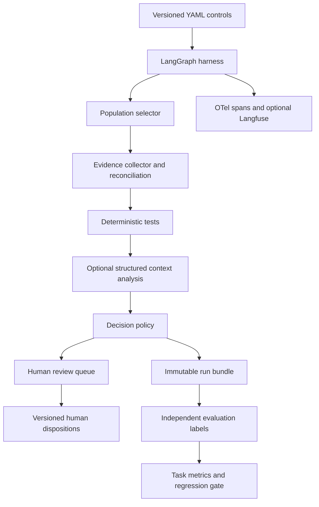

# Purchase-to-Pay Audit Harness

An evidence-first prototype for internal control testing. This is a control execution system with a constrained model component: YAML defines business scope and tests; Python validates evidence, runs deterministic rules, applies policy, and preserves original decisions. A language model can assess contextual vendor documentation but cannot grant an exception or override a deterministic failure.

The committed demo contains **120 entirely synthetic transactions, 20 scenario families, and 360 independently labeled control decisions**. No external model credentials are needed for the offline demo. The offline provider is a deterministic contract simulator, not an LLM, and makes no claim of calibrated confidence.

## Run locally

Python 3.12 or newer is required. Run commands from the repository root.

```sh
python3.12 -m venv .venv
source .venv/bin/activate
pip install -e '.[dev,observability]'
cp .env.example .env
# Set AUDIT_API_KEY in .env to a long random value before starting the API.
audit-harness evaluate --output artifacts/evaluation.json
audit-harness serve
```

The dataset is already generated. To reproduce it in a separate location:

```sh
audit-harness generate --output /tmp/audit-demo --count 120 --seed 42
AUDIT_DATA_DIR=/tmp/audit-demo audit-harness evaluate
```

Generation refuses to overwrite an existing transaction population. Ground truth is never passed to the harness or model. `evaluate` executes and persists a fresh run, evaluates it, writes metrics, and exits nonzero on a quality gate failure. `run` writes the full evidence and decision bundle to `artifacts/run.json`.

```sh
pytest --cov=audit_harness --cov-report=term-missing
ruff check .
ruff format --check .
```

**Verification in the build environment:** 25 core tests passed; one integration test module was skipped because LangGraph and Pandas could not be installed under the environment's DNS restrictions. This validates all 360 fixture outcomes through evidence collection, deterministic tests, and decision policy, plus persistence, review revision conflicts, and a mocked provider HTTP contract. It does **not** establish that the complete graph, server, Docker image, live provider, or Langfuse export has run successfully. The CI workflow installs all dependencies and runs the full suite and evaluation gate.

## Control semantics

| Control | Population | Test | Outcome handling |
| --- | --- | --- | --- |
| C1 | EUR payment **> 50,000** | Approval strictly before execution | Failed test → FAIL; unavailable/conflicting evidence → INSUFFICIENT_EVIDENCE |
| C2 | EUR payment **> 50,000** | Creator and approver resolve to distinct people | Same person, including account aliases → FAIL; unresolved identity → INSUFFICIENT_EVIDENCE |
| C3 | EUR payment **> 20,000** | Vendor age **0 ≤ age < 7 elapsed days** | Flag → NEEDS_HUMAN_REVIEW; model recommendation remains advisory; human can record POLICY_EXCEPTION |

Exactly EUR 50,000 is out of scope for C1/C2; exactly EUR 20,000 is out of scope for C3. Exactly seven days does not trigger C3. The prose rules' strict `>` takes precedence over the prompt's illustrative `gte` example. Out-of-scope results use PASS with `in_scope=false`; this is not a positive assertion of evidence compliance. Unsupported currency routes to human review without assuming FX conversion. Negative vendor age routes to review as a data integrity problem. Timestamps require offsets and compare absolute instants; monetary comparisons use Decimal.

A missing approval **file** means unavailable evidence. An approval register record explicitly stating `status: absent`, with no approver or timestamp, documents lack of approval and fails C1. C2 remains insufficient when there is no approver to identify. This avoids inferring a violation solely from a failed evidence retrieval.

C3 missing evidence also routes to human review, consistent with its narrower outcome set. Every non-PASS result enters the human review queue, including confirmed failures for acknowledgement. A confirmed deterministic failure cannot be turned into PASS by review; corrected evidence requires a fresh run. C3 exceptions require an explicit human disposition, rationale, reviewer identifier and evidence citations. The original machine result is preserved.

## API walkthrough

Open `http://localhost:8000/docs`; authorize requests with the `X-API-Key` header. `/health` is public. An absent API key configuration makes protected routes unavailable.

```sh
# Export the same secret configured in .env; do not commit it.
export AUDIT_API_KEY='your-local-secret'
curl -s -H "X-API-Key: $AUDIT_API_KEY" http://localhost:8000/controls
curl -s -X POST -H "X-API-Key: $AUDIT_API_KEY" http://localhost:8000/runs
```

Use the returned run ID:

```sh
export RUN_ID='replace-with-returned-id'
curl -s -H "X-API-Key: $AUDIT_API_KEY" "http://localhost:8000/runs/$RUN_ID"
curl -s -H "X-API-Key: $AUDIT_API_KEY" "http://localhost:8000/runs/$RUN_ID/reviews"
curl -s -H "X-API-Key: $AUDIT_API_KEY" "http://localhost:8000/runs/$RUN_ID/evaluation"
curl -s -X POST -H "X-API-Key: $AUDIT_API_KEY" -H 'Content-Type: application/json' \
  "http://localhost:8000/runs/$RUN_ID/reviews/TX-0006/C3" \
  -d '{"reviewer_id":"auditor-17","outcome":"POLICY_EXCEPTION","rationale":"Emergency purchase justification accepted after review of the supporting message.","citations":["TX-0006:approval_message"],"expected_revision":0}'
```

Review writes use optimistic concurrency: stale revisions return HTTP 409. Queue entries retain the original outcome, all review history, current revision, and resolution status. `POST /runs` executes the configured local population; it does not accept arbitrary filesystem paths or documents from clients. Runs commit atomically on success. Concurrent runs are rejected per worker. The local demo should run as a single process.

## Architecture and code map



| Component | Location | Responsibility |
| --- | --- | --- |
| Control definitions | `controls/*.yaml` | Objectives, scope, evidence prerequisites, test registry IDs, confidence thresholds |
| Schemas and settings | `models.py`, `config.py` | Strict Pydantic contracts, safe YAML loading, environment settings |
| Population and evidence | `evidence.py` | Pandas CSV loading, duplicate detection, bounded document reads, source and hash attribution |
| Deterministic tests | `rules.py` | Evidence reconciliation, chronological approval, canonical identity, vendor age |
| Model abstraction | `llm.py` | Provider protocol, offline simulator, working OpenAI-compatible HTTP adapter |
| Orchestration | `harness.py` | Compiled LangGraph: select → collect → test → analyze → decide |
| Decision policy | `policy.py` | Deterministic precedence, missing evidence routing, confidence handling, human gate |
| Persistence and review | `storage.py` | SQLAlchemy/SQLite, immutable run snapshots, hash checks, revisioned human actions |
| Application | `service.py`, `api.py`, `cli.py` | End-to-end runs, API authentication, command line workflows |
| Evaluation | `evaluation.py`, `synthetic.py` | Independent labels, exact population matching, task success and unsafe-pass gate |
| Observability | `observability.py` | Metadata-only JSON events, standard OTel spans, optional Langfuse observations |

All Python modules are in `src/audit_harness/`. Configuration is loaded on each run, validated against an allowlisted rule registry, and stored with the run. Configured rules cannot execute arbitrary code. Adding a rule requires an implementation, prerequisite validation, YAML definition and evaluation cases. Unknown rule IDs fail closed before execution.

Evidence is structured JSON from a simulated ERP export, one file per kind per transaction under `data/evidence/`. CSV vendor, user and approval registers support inspection; transaction-specific evidence snapshots are the authoritative test inputs. The adapter reconciles those snapshots against population fields. This prototype does not parse PDF invoices or perform OCR.

## Model providers

The default `offline` provider returns UNCERTAIN at a synthetic confidence of 0.5. Set these values in `.env` to enable the live HTTP adapter:

```dotenv
AUDIT_PROVIDER=openai-compatible
AUDIT_MODEL=gpt-4.1-mini
AUDIT_LLM_BASE_URL=https://api.openai.com/v1
AUDIT_LLM_API_KEY=your-secret
```

The endpoint must support Chat Completions JSON Schema structured output. Output is validated again by Pydantic; refusal, malformed schema, invented citation IDs, timeout and service failures produce review outcomes. The timeout bounds each context call; no implicit retry can indefinitely delay a run. Only flagged C3 context messages are sent to the provider. C1 and C2 never call a model.

To add Anthropic or AWS Bedrock, implement the `LLMProvider` protocol (`name`, `model`, `structured_generate`) and extend the provider factory and settings choices. Normalize provider-specific refusal and tool-output formats into the same Pydantic schema. Business rules and policies need no provider changes. Provider-specific adapters for those two services are extension points, not implemented integrations.

Evidence text is treated as untrusted data, has no tool execution privileges, and cannot modify policy. The prompt asks for concise rationale and exact citations, never private chain-of-thought. Citation validation proves source linkage, not entailment. Human review and independent evaluation remain necessary.

## Observability and reproducibility

The run bundle stores population snapshots and their hash, parsed control definitions and raw configuration hash, provider/model/prompt versions, all collected evidence contents with original source paths and SHA-256 hashes, deterministic test results, model judgments, error categories, final decisions, timestamps and runtime. This permits inspection after source files change. Original machine decisions never change when humans disposition exceptions.

Set `AUDIT_LANGFUSE_ENABLED=true` and the Langfuse environment variables in `.env` to enable SDK observations. The application emits metadata only, with control/model/prompt identifiers; no document content or credentials are included. Standard OTel trace providers can be configured by deployment auto-instrumentation; the app preserves an existing provider. The built-in SDK generates trace IDs and JSON events; it does not configure an OTLP endpoint or self-host a Langfuse stack. Langfuse observations are flushed on API shutdown.

Evaluation reports exact decision accuracy, **end-to-end business task success** (all three controls correct for a transaction), critical failure recall, unsafe PASS count, test citation coverage, review rate, a confusion matrix and individual mismatches. The default quality gate requires every expected decision to match and zero unsafe passes. Labels are scenario specifications authored independently from test logic. Fixture performance establishes deterministic regression behavior, not production model accuracy or confidence calibration. A live-model evaluation should add blinded human labels, citation entailment, exception quality, latency, cost, and calibrated abstention curves.

## Docker

```sh
cp .env.example .env
# Configure a secret in .env.
docker compose up --build
```

The service binds only to localhost in Compose, runs as a non-root user and persists SQLite in a named volume. Docker builds need package registry access. Dependencies have version bounds; a complete lockfile could not be generated in the restricted build environment. Resolve and lock dependencies in a connected environment before promoting a build.

## Prototype boundaries

This is a production-oriented prototype, not an unattended audit authority. The shared API key is a local access gate; `reviewer_id` is a recorded assertion and is not authenticated identity. Production deployment needs SSO/RBAC with reviewer identity binding, reviewer independence checks, evidence retention controls, database migrations, durable job scheduling, bounded parallelism, authenticated source connectors, and backups. SQLite is the supported demo persistence target; PostgreSQL can use the SQLAlchemy repository with an installed driver and a migration strategy.

Hash checks detect accidental stored-run mutation, not an attacker who can rewrite the database and recompute hashes. Review history is append-only through the application and preserves prior hashes, but is not externally signed or stored in WORM storage. Local evidence files must be stable for a run; a production collector should ingest a signed, immutable evidence manifest before orchestration. There is no background queue, PDF ingestion, frontend, automatic exception approval, or live model quality claim.
